# Projet Data Lakehouse — Architectures Data Lakehouse & Ingestion de données


**Auteur** : Niako KEBE — Étudiante en Data Engineering DIT  — kebeniako17@gmail.com

---

##  Objectif du projet

Construire une plateforme **Data Lakehouse** complète, de bout en bout, à partir d'une source de données publique (FakeStoreAPI) :

- **Ingestion** exclusive via Apache NiFi (aucun autre point d'entrée)
- **Stockage** objet S3-compatible via MinIO
- **Transformation** en couches Bronze → Silver → Gold avec Apache Spark, au format Iceberg
- **Catalogue versionné** des tables via Project Nessie
- **Orchestration** complète du pipeline via Apache Airflow
- **Interrogation SQL** des données via Dremio

##  Architecture

```
FakeStoreAPI
      │  (NiFi interroge l'API)
      ▼
MinIO — bucket "raw"  (JSON brut, zone d'atterrissage)
      │  (Spark lit raw/, écrit via le catalogue Nessie)
      ▼
MinIO — bucket "warehouse"  (tables Iceberg)
      │
      ├── BRONZE   (copie brute + métadonnées techniques)
      ├── SILVER   (nettoyage, typage, aplatissement — par domaine)
      └── GOLD     (jointures entre domaines + agrégations)
      │
      ▼
Dremio  (moteur SQL, connecté au catalogue Nessie)

Airflow orchestre l'ensemble : vérification de "raw/" → déclenchement
automatique de Bronze → Silver → Gold, toutes les heures.
Un DAG dédié (dag_backfill.py) reconstitue 6 mois d'historique en pilotant
NiFi via son API REST (Parameter Context paramétrable).
```

**Bonus réalisés** : 3e domaine "commandes" (`carts`) · Idempotence NiFi (`DetectDuplicate`) · Time travel Iceberg via Dremio
**Bonus non aboutis** : Supervision Prometheus/Grafana · Process Group paramétrable *(note : ce dernier point a en réalité été réalisé dans le cadre du backfill — voir plus bas)*

---

##  Sommaire

- [Étape 0 — Analyse et conception](#étape-0--analyse-et-conception)
- [Partie 1 — Infrastructure complète](#partie-1--conception-et-déploiement-de-linfrastructure-complète-3-pts)
- [Partie 2 — Déploiement NiFi](#partie-2--déploiement-et-configuration-dapache-nifi-2-pts)
- [Partie 3 — Flux d'ingestion NiFi](#partie-3--flux-dingestion-nifi-depuis-fakestoreapi-vers-minio-4-pts)
- [Partie 4 — Pipeline Spark médaillon](#partie-4--pipeline-spark-du-médaillon-complet-4-pts)
- [Partie 5 — Validation Dremio](#partie-5--test-et-validation-du-moteur-de-requête-dremio-3-pts)
- [Partie 6 — Orchestration Airflow](#partie-6--orchestration-airflow-et-démonstration-de-bout-en-bout-3-pts)
- [Partie 7 — Bonus](#partie-7--bonus-2-pts)
- [Difficultés majeures rencontrées](#-difficultés-majeures-rencontrées-résumé-transversal)
- [Démarrage rapide](#-démarrage-rapide)

---

## Étape 0 — Analyse et conception

**Décisions d'architecture prises avant tout développement :**

| Question | Décision |
|---|---|
| Buckets MinIO | `raw` (données brutes) et `warehouse` (tables Iceberg) |
| Structure des fichiers | `raw/snapshots/{date}/{domain}_{date}.json` |
| Granularité historique | Hebdomadaire (26 snapshots sur 6 mois) |
| Stratégie d'historique | Snapshots reconstitués (l'API n'a pas d'historique natif) |
| Bronze | Copie brute des JSON + `snapshot_date` |
| Silver | Données nettoyées, typées, aplaties |
| Gold | Agrégations et jointures |
| Déclenchement Airflow | Option A — planifié (vérification MinIO) |

**Analyse de l'API FakeStoreAPI** — 3 domaines identifiés (`products`, `users`, `carts`), avec relations : un panier référence des `productId` et un `userId`.

---

## Partie 1 — Conception et déploiement de l'infrastructure complète 

### Exigences du sujet
1. `docker-compose.yml` regroupant MinIO, PostgreSQL, cluster Spark, Nessie, Dremio, Airflow, Prometheus, Grafana, NiFi
2. Réseau Docker, volumes persistants, ports sans conflit
3. Démarrage et vérification de tous les services
4. Buckets MinIO + Nessie comme catalogue Spark/Dremio

### Services déployés

| # | Service | Image | Rôle | Port |
|---|---|---|---|---|
| 1 | PostgreSQL | `postgres:15` | Métadonnées Airflow + Nessie | 5432 |
| 2 | MinIO | `minio/minio` | Stockage S3-compatible | 9000/9001 |
| 3 | Nessie | `ghcr.io/projectnessie/nessie:0.77.1` | Catalogue Iceberg | 19120 |
| 4 | Spark Master | `apache/spark:3.5.6-...` | Pilotage cluster | 8080/7077 |
| 5 | Spark Worker | `apache/spark:3.5.6-...` | Exécution jobs | 8081 |
| 6 | Dremio | `dremio/dremio-oss:26.0.5` | Moteur SQL | 9047/31010 |
| 7 | Airflow (x3) | `apache/airflow:2.8.0` | Orchestration | 8082 |
| 8 | NiFi | `apache/nifi:2.8.0` | Ingestion | 8443/8880 |

### Interfaces vérifiées

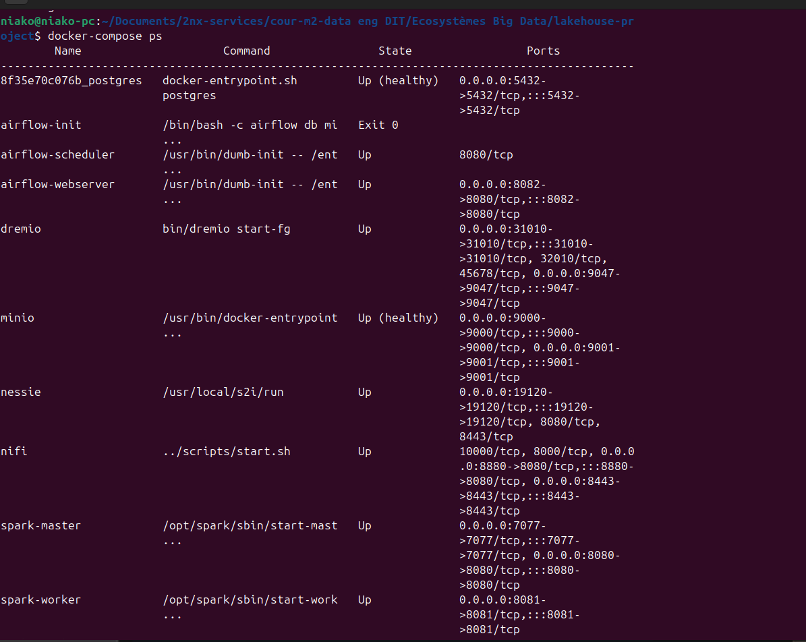
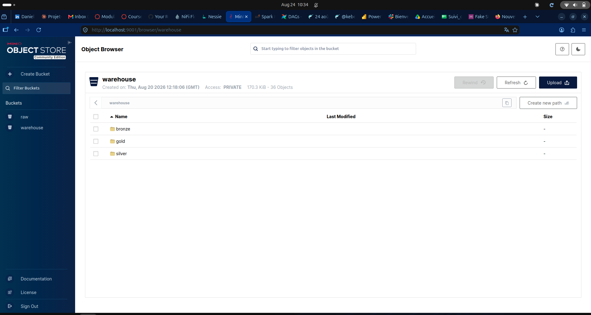
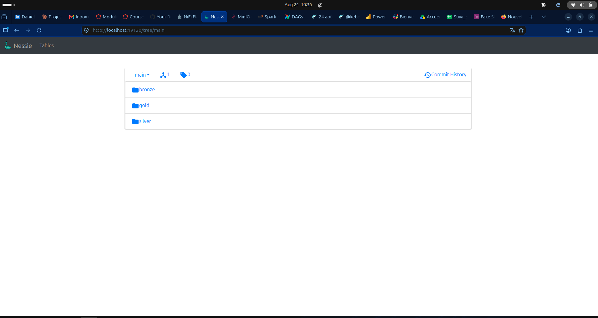
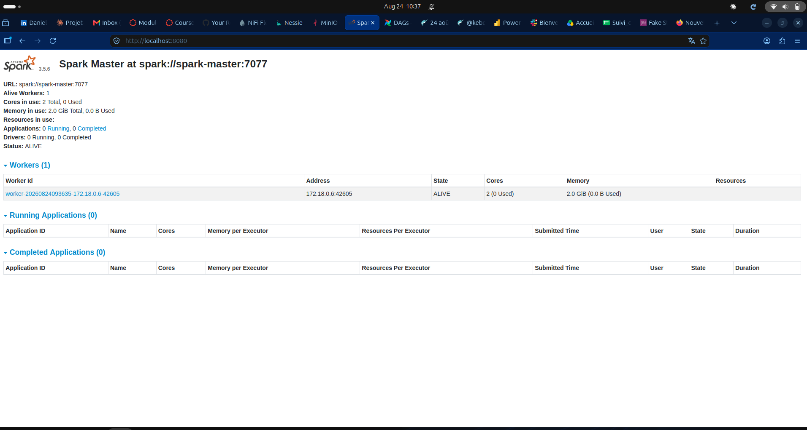
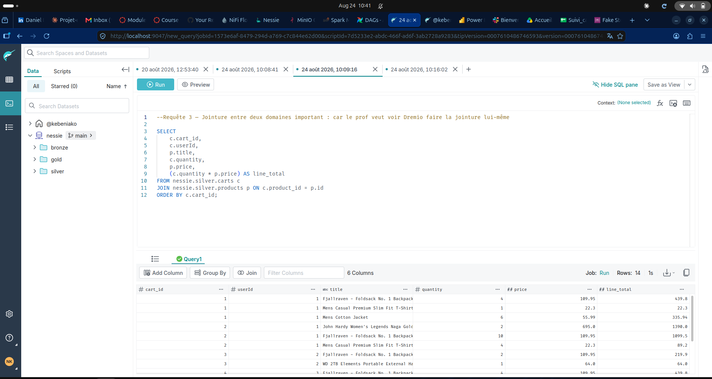
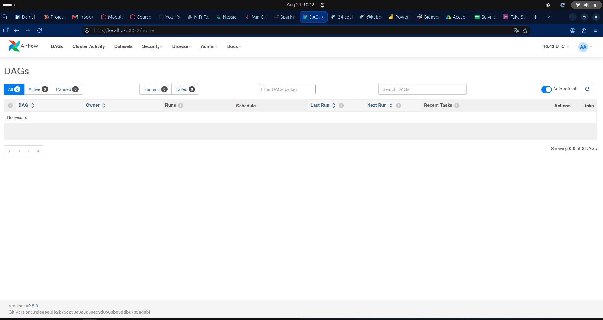


## Partie 2 — Déploiement et configuration d'Apache NiFi (2 pts)

### Exigences du sujet
1. Intégration réseau (résolution du nom `minio`)
2. Interface web exposée + identifiants documentés
3. Volume persistant pour l'état interne

### Réalisation

- Réseau `data-platform-network` partagé, dépendance explicite sur `minio` (healthy)
- Interface HTTPS sur `https://localhost:8443` (port HTTP décalé à 8880)
- **Choix retenu** : génération automatique des identifiants (authentification "Single User" par défaut de NiFi 2.x)
- Volumes persistants : `nifi_state`, `nifi_db`, `nifi_flowfile`, `nifi_content`, `nifi_provenance`

```bash
docker-compose logs nifi | grep -i username
docker-compose logs nifi | grep -i password
```

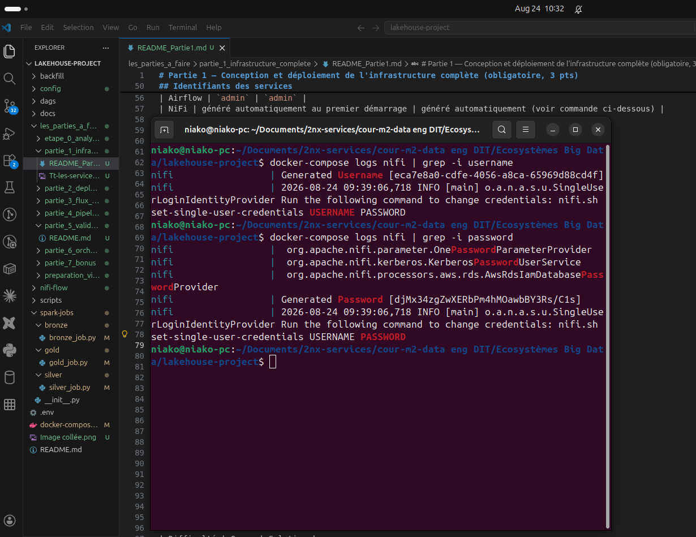


---

## Partie 3 — Flux d'ingestion NiFi depuis FakeStoreAPI vers MinIO 

### Exigences du sujet

Concevoir un dataflow NiFi qui interroge FakeStoreAPI et dépose les données JSON dans MinIO — aucun processeur imposé, endpoint S3 devant pointer vers `minio:9000`.

### Architecture du flow (par domaine)

```
InvokeHTTP (GET FakeStoreAPI)
      │ (Response)
      ▼
UpdateAttribute (snapshot_date + clé S3)
      │ (success)
      ▼
PutS3Object (dépôt dans raw)
```

Schéma dupliqué 3 fois (PRODUCT / USERS / CARTS) sur le canevas.

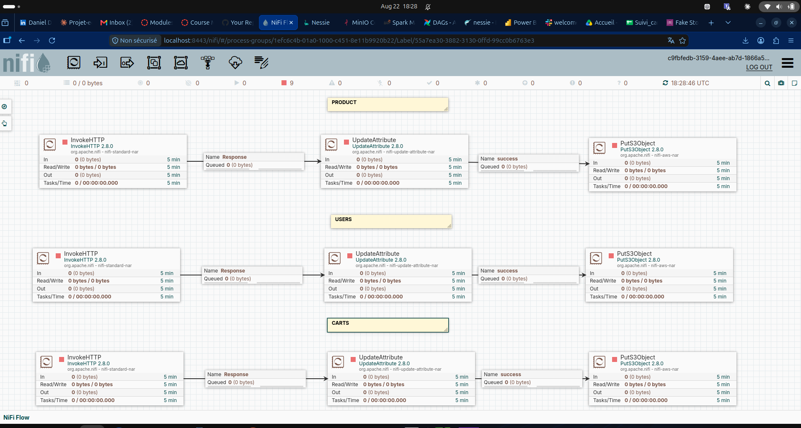

### Choix de conception
- **InvokeHTTP** : processeur natif recommandé pour appeler une API REST
- **UpdateAttribute** : étiquetage uniquement (`snapshot_date`, `s3.key`), aucune transformation métier
- **PutS3Object** : `Endpoint Override URL=http://minio:9000`, `Use Path Style Access=true`, credentials via `AWSCredentialsProviderControllerService`
- Structure de clé : `raw/snapshots/{yyyy-MM-dd}/{domain}_{yyyy-MM-dd}.json`

### Backfill des 6 mois (contrainte 4.1) 

Le flow de production reste inchangé. Un **second flow**, dans un **Process Group dédié `Backfill_Group`**, a été construit :

1. **Parameter Context** `backfill_context` créé, avec un paramètre `backfill_date`
2. Dans les 3 `UpdateAttribute` de ce groupe : `${now():format('yyyy-MM-dd')}` remplacé par `#{backfill_date}`

Résultat : NiFi peut écrire sous n'importe quelle date fournie de l'extérieur — condition nécessaire pour que `dag_backfill.py` (Airflow) puisse piloter 26 exécutions simulant 26 semaines, via l'API REST de NiFi.

**Validé** : 26 dossiers hebdomadaires (`2026-03-10` à `2026-09-01`) générés dans `raw/snapshots/`, avec les 3 domaines à chaque date.


---

## Partie 4 — Pipeline Spark du médaillon complet (4 pts)

### Exigences du sujet

Construire soi-même Bronze → Silver → Gold en Iceberg via Nessie, en cohérence avec l'historique de 6 mois.

### Couche Bronze — `bronze_job.py`

Copie brute + `snapshot_date` (extrait du chemin) + `ingestion_timestamp`.

| Table | Lignes avant backfill | **Lignes après backfill (28 dates)** |
|---|---|---|
| `bronze.products` | 20 | **560** |
| `bronze.users` | 10 | **280** |
| `bronze.carts` | 7 | **196** |

### Couche Silver — `silver_job.py`

| Domaine | Transformation |
|---|---|
| `products` | `rating.rate`/`rating.count` → colonnes simples |
| `users` | `name.*`, `address.*` aplatis |
| `carts` | Tableau `products[]` explosé (une ligne par produit du panier) |

### Couche Gold — `gold_job.py`

| Table | Question métier | Domaines joints |
|---|---|---|
| `gold.product_performance` | Produits les plus commandés, bien notés ? | carts × products |
| `gold.cart_summary` | Valeur d'un panier, provenance des clients | carts × products × users |
| `gold.category_trends` | Évolution des catégories dans le temps | products (agrégation) |

**`category_trends` a désormais une vraie profondeur temporelle** : **28 `snapshot_date` distincts** (112 lignes = 28 dates × 4 catégories), vérifiés dans Dremio.

**Limite honnête** : les valeurs (`avg_price`, `avg_rating`) sont identiques sur toutes les dates — FakeStoreAPI étant statique. Seule la structure temporelle est réelle ; une source évolutive produirait des tendances effectives avec la même architecture.

### Choix de conception
- Un job par couche, paramétré (`--domain` / `--table`) → réutilisable et découpable en tâches Airflow
- `createOrReplace()` à chaque exécution — reconstruit toute la table depuis `raw/`
- Colonnes qualifiées explicitement dans les jointures

---

## Partie 5 — Test et validation du moteur de requête Dremio 

### Exigences du sujet
1. Connexion Dremio ↔ Nessie, visibilité Bronze/Silver/Gold
2. Requêtes sur chaque couche
3. Jointure entre deux domaines faite par Dremio
4. Agrégation sur une table Gold
5. *(Valorisé)* Vues (virtual datasets)

### 1-2. Requêtes par couche

**Bronze** :
```sql
SELECT * FROM nessie.bronze.products LIMIT 10;
```
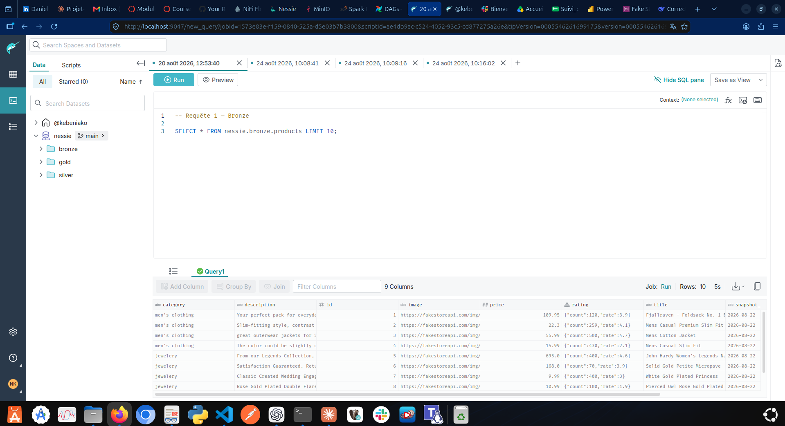

**Silver** :
```sql
SELECT firstname, lastname, address_city, address_geo_lat FROM nessie.silver.users;
```


### 3. Jointure réalisée par Dremio (pas une lecture d'une table déjà jointe)

```sql
SELECT c.cart_id, c.userId, p.title, c.quantity, p.price,
       (c.quantity * p.price) AS line_total
FROM nessie.silver.carts c
JOIN nessie.silver.products p ON c.product_id = p.id
ORDER BY c.cart_id;
```
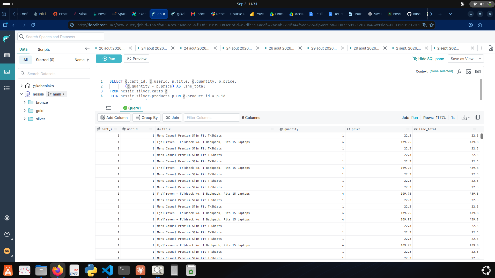

### 4. Agrégation sur Gold

```sql
SELECT category, num_products, avg_price, avg_rating
FROM nessie.gold.category_trends
ORDER BY avg_price DESC;
```
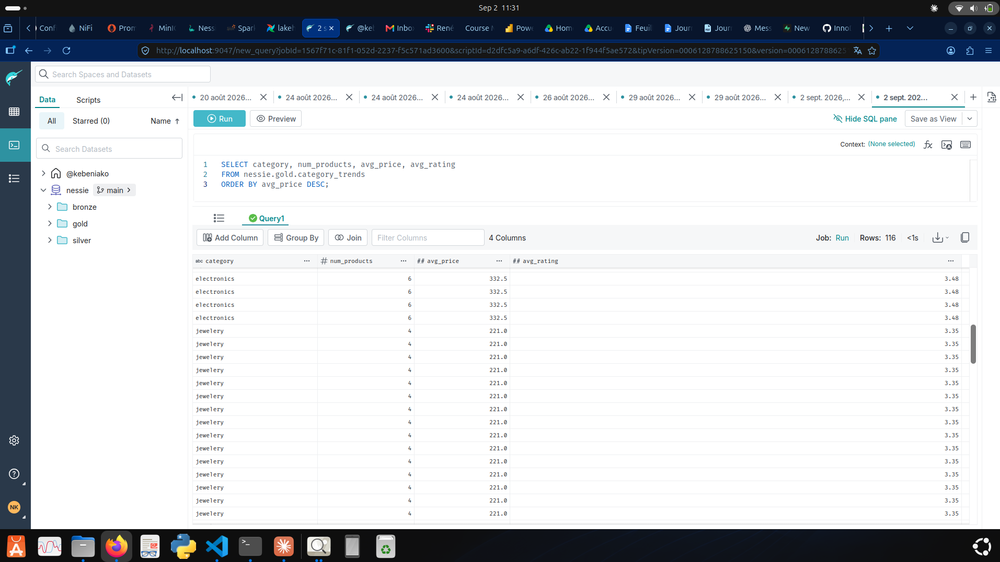

### 5. Vue (virtual dataset) — bonus valorisé

La requête de jointure a été sauvegardée comme vue **`cart_details`** (espace `@kebeniako`), réexécutée avec succès (mêmes  lignes).

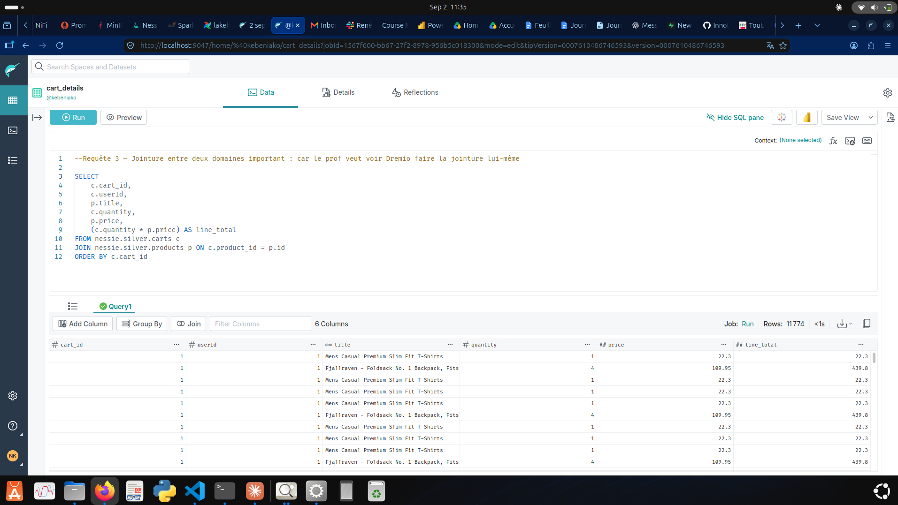

---

## Partie 6 — Orchestration Airflow et démonstration de bout en bout 

### Exigences du sujet

DAG orchestrant tout le pipeline, avec choix justifié entre déclenchement planifié (Option A) ou événementiel (Option B).

### Option retenue : A (planifiée)

Plus simple à mettre en œuvre et à déboguer

### Mise en place technique
1. **Image Airflow personnalisée** (`Dockerfile.airflow`) : Docker CLI + `boto3`
2. **Socket Docker de l'hôte monté** dans les conteneurs Airflow (`DOCKER_GID`)

Validé par :
```bash
docker exec -it airflow-scheduler docker exec spark-master \
  /opt/spark/bin/spark-submit /opt/spark/jobs/bronze/bronze_job.py --domain products
```

### Structure du DAG (`dag_daily_ingestion.py`)

```
check_raw_zone
      │
      ├──► bronze_products ──► silver_products ──┐
      ├──► bronze_users    ──► silver_users    ──┼──► gold_product_performance
      └──► bronze_carts    ──► silver_carts    ──┼──► gold_cart_summary
                                                   └──► gold_category_trends
```

- `check_raw_zone` (PythonOperator, `boto3`) : vérifie `raw/`, `AirflowSkipException` si données manquantes
- `schedule_interval="@hourly"`

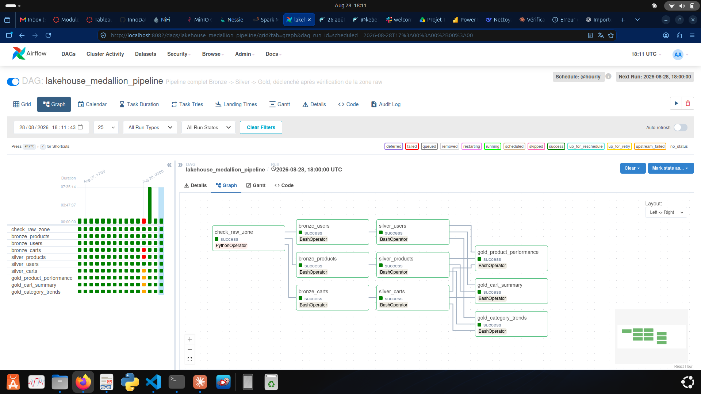

### Difficultés rencontrées et solutions

| Difficulté | Cause | Solution |
|---|---|---|
| DAG invisible dans Airflow malgré fichier valide | Bind mount `dags/` figé au moment de la création du conteneur | Recréation des conteneurs Airflow |
| Échecs partiels sur un run (double déclenchement) | Run manuel juste avant le run planifié | Non bloquant, run suivant réussi |
| Perte d'accès NiFi après redémarrages | Identifiants générés non retrouvés dans les logs tronqués | Réinitialisation des volumes NiFi, réimport du flow exporté |

### Démonstration de bout en bout

Run complet en `success` sur les 10 tâches. Vérification finale : `SELECT * FROM nessie.gold.category_trends;` dans Dremio après exécution automatique — preuve que NiFi → MinIO → Airflow → Spark → Nessie → Dremio fonctionne sans intervention manuelle.

---

## Partie 7 — Bonus 

### Options du sujet
1. Supervision NiFi via Prometheus/Grafana
2. Gestion de l'idempotence
3. Troisième domaine "commandes"
4. Process Group NiFi paramétrable
5. Fonctionnalité Iceberg avancée (time travel)

###  Bonus 1 — Troisième domaine "commandes"

`carts` intégré de bout en bout dès la conception initiale (ingestion, Bronze, Silver avec explosion, Gold via jointure).

###  Bonus 2 — Gestion de l'idempotence

Processeur `DetectDuplicate` ajouté entre `UpdateAttribute` et `PutS3Object`, avec `MapCacheServer`/`MapCacheClientService`. Clé vérifiée : `${s3.key}` (domaine + date). Doublon → relation `duplicate` (terminée) ; nouveauté → `non-duplicate` → écriture.

**Démontré** : 2 appels identiques → `DetectDuplicate` reçoit 2 flowfiles, n'en laisse sortir qu'1 seul (`PutS3Object` reçoit `In: 0` au 2e passage).

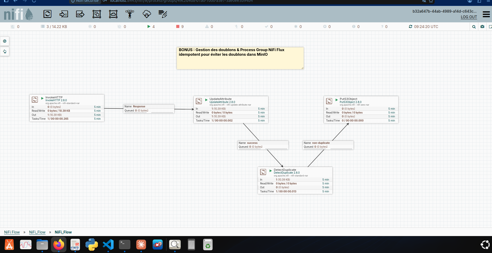

###  Bonus 3 — Time travel Iceberg via Dremio

```sql
SELECT * FROM TABLE(table_history('nessie.bronze.products'));

SELECT DISTINCT ingestion_timestamp
FROM nessie.bronze.products AT SNAPSHOT '1234005031019258899';

SELECT DISTINCT ingestion_timestamp FROM nessie.bronze.products;

```

###  Bonus 4 (réalisé dans le cadre du backfill) — Process Group NiFi paramétrable

Bien que non prévu initialement comme un bonus séparé, ce point a été concrètement réalisé pour résoudre la contrainte 4.1 : **Process Group `Backfill_Group`** avec **Parameter Context `backfill_context`** (paramètre `backfill_date`), utilisé pour piloter NiFi depuis l'extérieur via son API REST (voir Partie 3).

###  Bonus non abouti — Supervision Prometheus/Grafana

**Tentative faite, non aboutie.** Difficultés rencontrées, par ordre chronologique :
1. Le "Reporting Task Prometheus" du sujet n'existe plus dans NiFi 2.8.0 (supprimé depuis NiFi 1.x) — remplacé par un endpoint REST natif (`/nifi-api/flow/metrics/prometheus`) nécessitant un jeton JWT
2. Disque saturé (répertoires de travail Spark jamais nettoyés sur plusieurs jours) → corruption de l'état interne NiFi
3. Erreur `400 Bad Request` — validation stricte du Host header de NiFi, refusant `nifi:8443` comme hôte de confiance
4. Bug connu de l'image officielle NiFi (NIFI-8784) rendant peu fiable la variable d'environnement dédiée en mode "Single User"

**Décision** : priorité donnée à la consolidation des bonus fonctionnels plutôt que de risquer l'infrastructure principale.

---

##  Démarrage rapide

```bash
git clone <url-du-depot>
cd lakehouse-project

# Créer le fichier .env (voir Partie 1 pour le détail des variables)
# Renseigner notamment DOCKER_GID : getent group docker | cut -d: -f3

docker-compose up -d
```

Attendre que tous les services soient `Up` (`docker-compose ps`).

**Récupération des identifiants NiFi** (générés au premier démarrage) :
```bash
docker-compose logs nifi | grep -i "generated"
```

---

##  Structure du dépôt
```
lakehouse-project/
│
├── README.md                          # Documentation complète du projet
├── docker-compose.yml                 # Orchestration des 8 services Docker
├── Dockerfile.airflow                 # Image personnalisée Airflow 
├── .env                               # Variables d'environnement 
├── .gitignore                         # Fichiers exclus du versionnement
│
├── dags/                              # DAGs Apache Airflow
│   ├── dag_daily_ingestion.py         # DAG principal : orchestration quotidienne du pipeline
│   └── dag_backfill.py                # DAG de backfill : reconstitution des 6 mois d'historique
│
├── spark-jobs/                        # Jobs Spark du médaillon (Bronze → Silver → Gold)
│   ├── bronze/
│   │   └── bronze_job.py              # Copie brute + snapshot_date + ingestion_timestamp
│   ├── silver/
│   │   └── silver_job.py              # Nettoyage, typage, aplatissement par domaine
│   └── gold/
│       └── gold_job.py                # Jointures entre domaines + agrégations métier
│
├── nifi-flow/
│   └── nifi_flow.json                 # Export du flow NiFi (3 domaines + backfill)
│
├── config/                            # Fichiers de configuration 
│   ├── nessie-config.yml              # Configuration du catalogue Project Nessie
│   └── spark-defaults.conf            # Configuration Spark (Iceberg, Nessie, MinIO)
│
├── scripts/
│   └── init-minio.sh                  # Script d'initialisation des buckets MinIO
│
└── Feuille-de-route/                  # Captures d'écran par partie (soutenance)
    ├── partie_1_infrastructure_complete/
    │   ├── partie1-tous-services-up.png
    │   ├── partie1-minio-console.png
    │   ├── partie1-nessie-api.png
    │   ├── partie1-spark-master-ui.png
    │   ├── partie1-dremio-ui.png
    │   └── partie1-airflow-ui.png
    ├── partie_2_deploiement_nifi/
    │   └── partie2-nifi-identifiants.png
    ├── partie_3_flux_ingestion_nifi/
    │   ├── partie3-flow-3-domaines.png
    │   └── backfill-des-6-mois.png
    ├── partie_4_pipeline_spark/       # (à ajouter si nécessaire)
    ├── partie_5_validation_dremio/
    │   ├── partie5-requete-bronze.png
    │   ├── partie5-requete-silver.png
    │   ├── partie5-jointure-carts-products.png
    │   ├── partie5-agregation-gold.png
    │   └── partie5-virtual-dataset.png
    ├── partie_6_orchestration_airflow/
    │   └── partie6-dag-succes.png
    └── partie_7_bonus/
        └── partie7-detectduplicate-flow.png
```  
      
Merci Monsieur PENE **https://github.com/PENE18**  pour ce projet, qui m'a permis de mettre en pratique les notions étudiées en cours et de mieux comprendre les mécanismes d'ingestion de données avec Apache NiFi, ainsi que leur intégration dans une architecture Data Lakehouse.